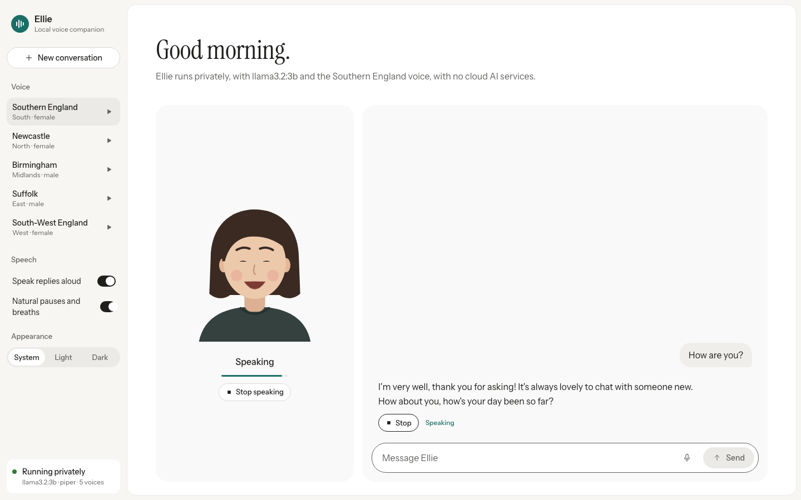
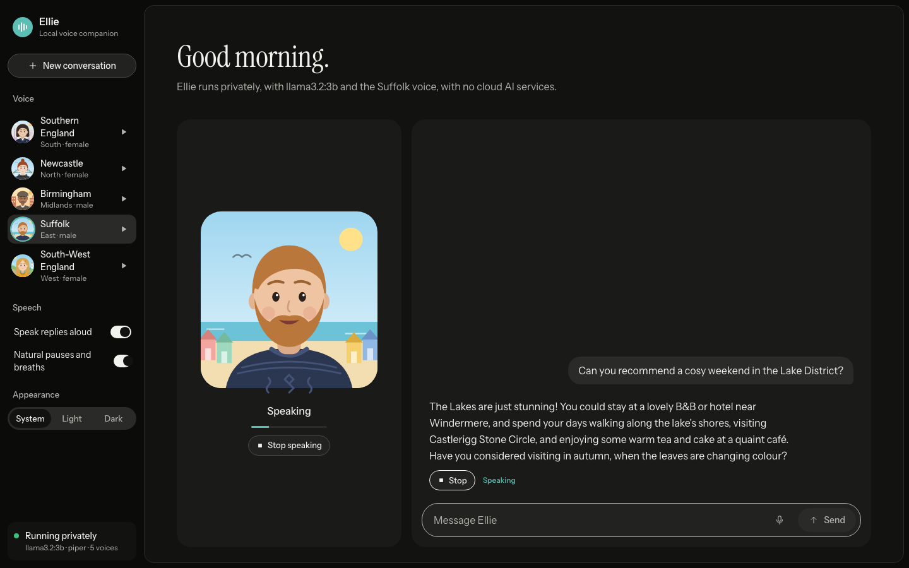
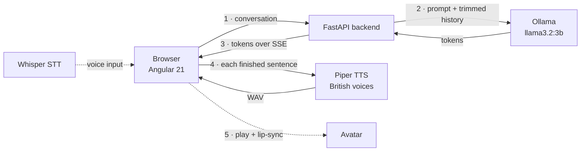

# Ellie: a local LLM that talks back in British English

Type a message and a **small language model running on our own server** writes a reply. A
**local British English voice** reads it aloud as it is written, and an animated avatar lip-syncs
to it. No cloud AI service is used at any step.

**▶ Live demo: [ellie-rosy.vercel.app](https://ellie-rosy.vercel.app)**

> The backend sleeps when nobody is using it, to keep costs near zero. The first visit after a
> quiet spell shows *"Waking Ellie up…"* for up to a minute while the model loads; after that,
> replies start in about a second.

<p align="center">
  
</p>

<p align="center">
  
  &nbsp;
  
</p>

[](https://github.com/ShivaTeja05/Local-LLM-Based-Text-to-Speech-Application/actions/workflows/ci.yml)


---

## Contents

- [How this meets the brief](#how-this-meets-the-brief)
- [What it does](#what-it-does)
- [How it works](#how-it-works)
- [Run it yourself](#run-it-yourself)
- [Repository layout](#repository-layout)
- [Tests](#tests)
- [Documentation](#documentation)
- [Known limitations](#known-limitations)

## How this meets the brief

Every requirement of the technical task, where it is built, and how it is checked.

| The brief asks for | Built | Checked by |
|---|---|---|
| A web prototype in JavaScript with Angular | Angular 21 front end ([`frontend/`](frontend/)) | Unit tests (Vitest) and browser tests (Playwright) |
| Natural-language input, a response in writing **and** spoken British English | Text box (and optional push-to-talk); the reply streams in as text and is spoken as it is written | `e2e/app.spec.ts`: *the brief example* |
| A **small, locally running LLM**, not a cloud API | `llama3.2:3b` (3B parameters) in Ollama, in our own container; optional LoRA fine-tune | `backend/tests/test_e2e.py` against the real model |
| Coherent replies to basic conversation | British persona prompt, context window and memory; evaluated on 40 prompts × 3 samples | [`training/eval`](training/eval/), memory tests |
| Input sent to the model, response returned to the front end | FastAPI, streamed over Server-Sent Events | API and end-to-end tests |
| British English speech, a natural UK voice, generated locally | Piper (local, no cloud TTS): five regional UK voices; natural pauses tuned to measured speech | `test_piper_engine.py`, `e2e/pauses.spec.ts` |
| A **button to play** the spoken response | ▶ Play / ■ Stop on every reply (replays from a cache) | `e2e/app.spec.ts`: *replay uses the cached audio* |
| An option to **switch speech on or off** | *Speak replies aloud* switch (remembered) | `e2e/app.spec.ts`: *speech off* |
| The example: "How are you?" → "I'm very well, thank you. How are you?" spoken aloud | A starter button for exactly this prompt | `e2e/app.spec.ts`: written, spoken sentence by sentence, lips moving |
| *(Optional)* An animated avatar with lip movements and facial expressions | Lip-sync from the audio's loudness, blinks, moods per sentence, nods, gestures, eyes that follow you; a character for each voice | `e2e/gestures.spec.ts`, `e2e/gaze.spec.ts` |
| A web application suitable for deployment on a web server | `docker compose up` (nginx + backend + Ollama); live on Cloud Run + Vercel | [docs/DEPLOYMENT.md](docs/DEPLOYMENT.md) |
| Front-end **and** back-end components | `frontend/` (Angular) and `backend/` (FastAPI) | CI on every push |
| Source code and brief instructions to install, configure and run | This repository; [Run it yourself](#run-it-yourself), [docs/INSTALL.md](docs/INSTALL.md), `.env.example` | |

**Browsers tested:** Chrome/Edge (Chromium) and Safari (WebKit) run the core browser suite;
phone and tablet layouts are tested too. Firefox is not yet covered by the automated tests.

## What it does

**The brief**
- Text input → a **small local LLM** (`llama3.2:3b` through Ollama) → the reply is shown on screen.
- The reply is **spoken in British English** by a local TTS engine (Piper) *while it is still
  being written*: the voice starts after the first few words (at the first comma, or about twelve
  words in), then continues sentence by sentence.
- **▶ Play / ■ Stop** on every reply (replays from a cache) and a **Speak replies aloud** switch.
- **Lip-synced avatar**: the mouth follows the real loudness of the audio at 60 fps, with blinking,
  a thinking look, and happy or concerned expressions read from the reply.

**Beyond the brief**
- **Five regional English voices**: Southern England, Newcastle, Birmingham, Suffolk and
  South-West England, each with a ▶ preview.
- **A character for each voice**, dressed in a nod to its region and set against a sunny local
  scene: a navy blazer by the London Eye, a striped scarf under the Tyne Bridge, a flat cap and
  waistcoat on a Birmingham canal, a fisherman's jumper by Suffolk beach huts, a yellow oilskin in
  a Cornish cove.
- **She reacts to you, not just to her own words:** she laughs at a joke (happy closed eyes),
  cheers good news with both hands up, puts a hand on her heart for sad news or thanks, blushes at a
  compliment, leans in and nods along while you type, rests her chin on her hand while she thinks,
  gives a thumbs up for praise and shrugs when unsure. At rest she breathes, sways and blinks.
- **Eyes that watch you**: while quiet, the avatar follows your pointer and your typing; while
  speaking, it looks straight at you.
- **Natural pauses and breaths**: each clip's own silence is trimmed, then pauses follow measured
  human speech (a comma about half a full stop) with a breath every few seconds (switchable).
- **🎤 Push-to-talk voice input** with local Whisper: what you say is written into the box for you
  to check before sending.
- **Conversation memory**: follow-ups work, and long chats are folded into a short memory note so
  Ellie still remembers your name later.
- **Your data stays on your device**: the conversation, memory note and voice fingerprint live in a
  small database in your own browser (IndexedDB), deleted after 30 days unused. A **Your data** panel
  shows each item with its own delete button, and the server keeps nothing ([privacy](docs/PRIVACY.md)).
- **🎙️ Use my voice: hear yourself speak British English.** Read a short passage (or upload a
  recording) and Ellie answers *in your voice*, with her British pronunciation: Piper speaks, then
  an open voice converter (OpenVoice v2) gives it your voice quality. No training, about 0.6 s per
  sentence; the recording is never stored, and the voice fingerprint stays in your browser
  ([how it works](docs/ARCHITECTURE.md#63-use-my-voice-hear-yourself-speak-british-english-built)).
- **Measured against real British speech:** a corpus study compares Ellie's replies with the
  Spoken BNC2014 (Britishness index, Log Ratio, keywords, turn length). The fine-tune makes her
  spelling and vocabulary fully British (0.77 → 1.00), and the study shows what is still missing:
  she over-uses *lovely* 23× and lacks the *yeah*, *you know* and tag questions of real talk
  ([research/](research/README.md)).
- **A LoRA fine-tune** of the model that behaves like Ellie with a one-line prompt instead of a
  256-token one ([training/](training/README.md)). **Compare models** shows the recorded 120-reply
  results and sends the same new message to Standard and v2, with separate replies, timings and
  playback in the selected voice. Choose matched one-line prompts or the app's normal prompts.
- Light, dark and system themes; works on desktop, tablet and phone; keyboard accessible.
- **Deployed** on Google Cloud Run + Vercel, with rate limits, a daily ceiling and security headers
  ([deployment](docs/DEPLOYMENT.md), [security](docs/SECURITY.md)).

## How it works



1. The browser sends the whole conversation; the backend trims it to fit the model's context
   window in a way that keeps Ollama's prompt cache effective.
2. The model streams its reply token by token over Server-Sent Events.
3. The frontend splits the stream into sentences. Each finished sentence goes to Piper while the
   next one is still being written, so speech and text arrive together.
4. The Web Audio API plays the clips in order and measures their loudness to drive the mouth.

| Part | Technology |
|---|---|
| Frontend | Angular 21 (signals, standalone components), Web Audio API, animated SVG avatar |
| Backend | Python, FastAPI, Server-Sent Events |
| LLM | Ollama + `llama3.2:3b` (Q4_K_M); optional fine-tune `ellie-british` |
| Text-to-speech | Piper `en_GB-vctk-medium` (five regional speakers); Kokoro-82M as an optional second engine |
| Speech-to-text | faster-whisper `base.en` |
| Hosting | Google Cloud Run (backend + model in one container, scales to zero) · Vercel (frontend) |

The full design, with the reasons for each choice, is in [docs/ARCHITECTURE.md](docs/ARCHITECTURE.md).

## Run it yourself

### With Docker (one command)

Needs [Docker](https://docs.docker.com/get-docker/) (Compose v2.24+) and about 6 GB of disk.

```bash
docker compose up -d --build
```

Open <http://localhost:8080>. The first start downloads the model (~2 GB), so it takes a few
minutes; later starts take seconds.

**On a Mac**, Docker cannot use the GPU. If the [Ollama app](https://ollama.com/download) is
installed, use it instead (about twice as fast):

```bash
docker compose -f docker-compose.yml -f docker-compose.host-ollama.yml up -d --build
```

### Without Docker

Needs Python 3.11+, Node 20.19+ and [Ollama](https://ollama.com/download).

```bash
ollama pull llama3.2:3b
```

```bash
cd backend && python3 -m venv .venv && .venv/bin/pip install -r requirements-dev.txt && ./scripts/download_voices.sh
```

```bash
cd frontend && npm install && npm run build
```

```bash
cd backend && .venv/bin/uvicorn app.main:app --port 8000
```

Open <http://localhost:8000>. Step-by-step instructions, the dev server, configuration and the API
are in [docs/INSTALL.md](docs/INSTALL.md).

## Repository layout

```text
├── backend/                 FastAPI app
│   ├── app/
│   │   ├── api/             routes: chat (SSE), tts, stt, memory, health
│   │   ├── llm/             Ollama adapter, prompts, context trimming, memory notes
│   │   ├── tts/             Piper + Kokoro engines, regional voices, text normalisation
│   │   ├── stt/             Whisper engine
│   │   └── protection.py    rate limits, daily ceiling, concurrency cap, security headers
│   ├── tests/               unit, API and end-to-end tests (pytest)
│   └── scripts/             voice and model downloads
├── frontend/                Angular 21 app
│   ├── src/app/core/        API client, SSE parser, sentence splitter, audio player, state
│   ├── src/app/ui/          avatar, chat, composer, settings panel
│   └── e2e/                 Playwright tests against the real stack
├── deploy/cloudrun/         Dockerfile, Cloud Build config, start script, status report
├── training/                LoRA fine-tune: dataset, training scripts, evaluation, results
├── docs/                    architecture, install, deployment, security, screenshots
└── docker-compose.yml       nginx + backend + Ollama in one command
```

## Tests

| Suite | What it covers | Command |
|---|---|---|
| Backend unit + API | prompts, trimming, memory, TTS normalisation, voices, rate limits, security headers | `cd backend && .venv/bin/python -m pytest -q -m "not integration"` |
| Backend end to end | the real chain Ollama → API → Piper → WAV: style, memory, every voice, concurrency | `cd backend && .venv/bin/python -m pytest tests/test_e2e.py -v -s` |
| Frontend unit | SSE parser, sentence splitter, audio queue, conversation service | `cd frontend && npm test` |
| Browser end to end | the brief's "How are you?" example spoken with lip-sync, voices, memory, voice input, phone layout | `cd frontend && npm run e2e` |

The unit suites run on every push in [GitHub Actions](.github/workflows/ci.yml).

## Documentation

| Document | Contents |
|---|---|
| [docs/ARCHITECTURE.md](docs/ARCHITECTURE.md) | Design decisions, request flow, prompt design, context window, TTS, avatar, voice input |
| [docs/INSTALL.md](docs/INSTALL.md) | Full local setup, configuration, tests and the HTTP API |
| [docs/DEPLOYMENT.md](docs/DEPLOYMENT.md) | How the live demo runs on Cloud Run + Vercel, cost, monitoring, redeploying |
| [docs/SECURITY.md](docs/SECURITY.md) | Rate limits, the cost ceiling, headers, and the results of a security review |
| [docs/PRIVACY.md](docs/PRIVACY.md) | What is stored, where (your browser's own database), for how long, and how to delete it |
| [training/README.md](training/README.md) | The LoRA fine-tune: dataset, training, evaluation and results |
| [research/README.md](research/README.md) | **How British is Ellie?** Her replies measured against 10 million words of real British conversation (Spoken BNC2014) |

## Known limitations

- A 3B model can occasionally state a fact wrongly with confidence. It is tuned for friendly,
  spoken conversation, not factual accuracy.
- The live demo runs on CPUs, not a GPU, so a long reply takes several seconds, and the first
  visit after a quiet spell waits for the model to load.
- The live demo defaults to **Standard** and also offers the v2 **Fine-tuned** model. The fine-tune
  improves style consistency but regresses on the small factual and name-recall checks; the
  **Compare models** view shows both the gains and the trade-offs. Experimental v3 is not offered.
- Piper reads most text well; unusual formats (some abbreviations or codes) can sound odd.
  Money, dates and URLs are handled in `backend/app/tts/normalise.py`.
