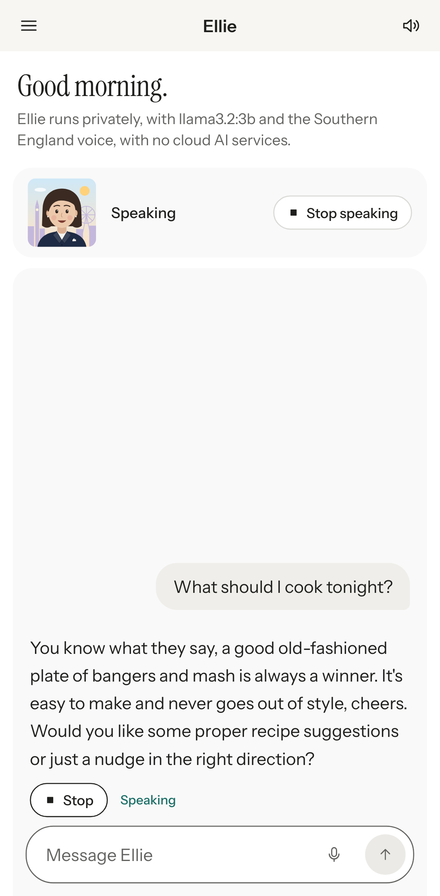
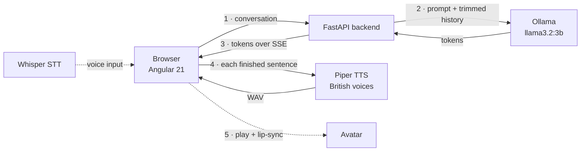

# Ellie: a local LLM that talks back in British English

Type a message and a **small language model running on our own server** writes a reply. A
**local British English voice** reads it aloud as it is written, and an animated avatar lip-syncs
to it. No cloud AI service is used at any step.

**▶ Live demo: [ellie-rosy.vercel.app](https://ellie-rosy.vercel.app)**

> The backend sleeps when nobody is using it, to keep costs near zero. The first visit after a
> quiet spell shows *"Waking Ellie up…"* for up to a minute while the model loads; after that,
> replies start in about a second.

<p align="center">
  
</p>

<p align="center">
  
  &nbsp;
  
</p>

[](https://github.com/ShivaTeja05/Local-LLM-Based-Text-to-Speech-Application/actions/workflows/ci.yml)


---

## Contents

- [What it does](#what-it-does)
- [How it works](#how-it-works)
- [Run it yourself](#run-it-yourself)
- [Repository layout](#repository-layout)
- [Tests](#tests)
- [Documentation](#documentation)
- [Known limitations](#known-limitations)

## What it does

**The brief**
- Text input → a **small local LLM** (`llama3.2:3b` through Ollama) → the reply is shown on screen.
- The reply is **spoken in British English** by a local TTS engine (Piper), sentence by sentence,
  *while it is still being written*, so the voice starts about a second after you press Enter.
- **▶ Play / ■ Stop** on every reply (replays from a cache) and a **Speak replies aloud** switch.
- **Lip-synced avatar**: the mouth follows the real loudness of the audio at 60 fps, with blinking,
  a thinking look, and happy or concerned expressions read from the reply.

**Beyond the brief**
- **Five regional English voices**: Southern England, Newcastle, Birmingham, Suffolk and
  South-West England, each with a ▶ preview.
- **A character for each voice**, dressed in a nod to its region and set against a sunny local
  scene: a navy blazer by the London Eye, a striped scarf under the Tyne Bridge, a flat cap and
  waistcoat on a Birmingham canal, a fisherman's jumper by Suffolk beach huts, a yellow oilskin in
  a Cornish cove.
- **Eyes that watch you**: while quiet, the avatar follows your pointer and your typing; while
  speaking, it looks straight at you.
- **Natural pauses and breaths** between sentences, sized like a person's (switchable).
- **🎤 Push-to-talk voice input** with local Whisper: what you say is written into the box for you
  to check before sending.
- **Conversation memory**: follow-ups work, and long chats are folded into a short memory note so
  Ellie still remembers your name later.
- **A LoRA fine-tune** of the model that behaves like Ellie with a one-line prompt instead of a
  256-token one ([training/](training/README.md)).
- Light, dark and system themes; works on desktop, tablet and phone; keyboard accessible.
- **Deployed** on Google Cloud Run + Vercel, with rate limits, a daily ceiling and security headers
  ([deployment](docs/DEPLOYMENT.md), [security](docs/SECURITY.md)).

## How it works



1. The browser sends the whole conversation; the backend trims it to fit the model's context
   window in a way that keeps Ollama's prompt cache effective.
2. The model streams its reply token by token over Server-Sent Events.
3. The frontend splits the stream into sentences. Each finished sentence goes to Piper while the
   next one is still being written, so speech and text arrive together.
4. The Web Audio API plays the clips in order and measures their loudness to drive the mouth.

| Part | Technology |
|---|---|
| Frontend | Angular 21 (signals, standalone components), Web Audio API, animated SVG avatar |
| Backend | Python, FastAPI, Server-Sent Events |
| LLM | Ollama + `llama3.2:3b` (Q4_K_M); optional fine-tune `ellie-british` |
| Text-to-speech | Piper `en_GB-vctk-medium` (five regional speakers); Kokoro-82M as an optional second engine |
| Speech-to-text | faster-whisper `base.en` |
| Hosting | Google Cloud Run (backend + model in one container, scales to zero) · Vercel (frontend) |

The full design, with the reasons for each choice, is in [docs/ARCHITECTURE.md](docs/ARCHITECTURE.md).

## Run it yourself

### With Docker (one command)

Needs [Docker](https://docs.docker.com/get-docker/) (Compose v2.24+) and about 6 GB of disk.

```bash
docker compose up -d --build
```

Open <http://localhost:8080>. The first start downloads the model (~2 GB), so it takes a few
minutes; later starts take seconds.

**On a Mac**, Docker cannot use the GPU. If the [Ollama app](https://ollama.com/download) is
installed, use it instead (about twice as fast):

```bash
docker compose -f docker-compose.yml -f docker-compose.host-ollama.yml up -d --build
```

### Without Docker

Needs Python 3.11+, Node 20.19+ and [Ollama](https://ollama.com/download).

```bash
ollama pull llama3.2:3b
```

```bash
cd backend && python3 -m venv .venv && .venv/bin/pip install -r requirements-dev.txt && ./scripts/download_voices.sh
```

```bash
cd frontend && npm install && npm run build
```

```bash
cd backend && .venv/bin/uvicorn app.main:app --port 8000
```

Open <http://localhost:8000>. Step-by-step instructions, the dev server, configuration and the API
are in [docs/INSTALL.md](docs/INSTALL.md).

## Repository layout

```text
├── backend/                 FastAPI app
│   ├── app/
│   │   ├── api/             routes: chat (SSE), tts, stt, memory, health
│   │   ├── llm/             Ollama adapter, prompts, context trimming, memory notes
│   │   ├── tts/             Piper + Kokoro engines, regional voices, text normalisation
│   │   ├── stt/             Whisper engine
│   │   └── protection.py    rate limits, daily ceiling, concurrency cap, security headers
│   ├── tests/               unit, API and end-to-end tests (pytest)
│   └── scripts/             voice and model downloads
├── frontend/                Angular 21 app
│   ├── src/app/core/        API client, SSE parser, sentence splitter, audio player, state
│   ├── src/app/ui/          avatar, chat, composer, settings panel
│   └── e2e/                 Playwright tests against the real stack
├── deploy/cloudrun/         Dockerfile, Cloud Build config, start script, status report
├── training/                LoRA fine-tune: dataset, training scripts, evaluation, results
├── docs/                    architecture, install, deployment, security, screenshots
└── docker-compose.yml       nginx + backend + Ollama in one command
```

## Tests

| Suite | What it covers | Command |
|---|---|---|
| Backend unit + API | prompts, trimming, memory, TTS normalisation, voices, rate limits, security headers | `cd backend && .venv/bin/python -m pytest -q -m "not integration"` |
| Backend end to end | the real chain Ollama → API → Piper → WAV: style, memory, every voice, concurrency | `cd backend && .venv/bin/python -m pytest tests/test_e2e.py -v -s` |
| Frontend unit | SSE parser, sentence splitter, audio queue, conversation service | `cd frontend && npm test` |
| Browser end to end | the brief's "How are you?" example spoken with lip-sync, voices, memory, voice input, phone layout | `cd frontend && npm run e2e` |

The unit suites run on every push in [GitHub Actions](.github/workflows/ci.yml).

## Documentation

| Document | Contents |
|---|---|
| [docs/ARCHITECTURE.md](docs/ARCHITECTURE.md) | Design decisions, request flow, prompt design, context window, TTS, avatar, voice input |
| [docs/INSTALL.md](docs/INSTALL.md) | Full local setup, configuration, tests and the HTTP API |
| [docs/DEPLOYMENT.md](docs/DEPLOYMENT.md) | How the live demo runs on Cloud Run + Vercel, cost, monitoring, redeploying |
| [docs/SECURITY.md](docs/SECURITY.md) | Rate limits, the cost ceiling, headers, and the results of a security review |
| [training/README.md](training/README.md) | The LoRA fine-tune: dataset, training, evaluation and results |

## Known limitations

- A 3B model can occasionally state a fact wrongly with confidence. It is tuned for friendly,
  spoken conversation, not factual accuracy.
- The live demo runs on CPUs, not a GPU, so a long reply takes several seconds, and the first
  visit after a quiet spell waits for the model to load.
- The fine-tuned model is available locally (the **Standard / Fine-tuned** switch). The live demo
  runs the standard model only, to keep the server image small.
- Piper reads most text well; unusual formats (some abbreviations or codes) can sound odd.
  Money, dates and URLs are handled in `backend/app/tts/normalise.py`.
