# Architecture — Local LLM Text-to-Speech Conversational App

A web app where a user types a message. A **small LLM running locally** writes a reply, the
reply appears on screen, and a **local British English TTS voice** reads it aloud. An optional
animated avatar lip-syncs to the speech.

Design goals, in order of priority:

1. **Everything runs locally.** No cloud LLM and no cloud TTS.
2. **Natural conversation.** Short, spoken-style British replies.
3. **Low perceived latency.** Text streams token by token, and speech starts after the first sentence.
4. **Simple to run and deploy.** `docker compose up`, or three commands in dev.
5. **Swappable parts.** The LLM model and the TTS engine are configured, not hard-coded.

---

## 1. Tech stack

| Layer | Choice | Why |
|---|---|---|
| Front end | **Angular 21 LTS** (standalone components, signals, zoneless), TypeScript, SCSS; Vitest for unit tests, Playwright for end-to-end | The task names Angular. Signals keep the chat and audio state simple. 21 is the LTS line and runs on Node ≥ 24.0 (Angular 22 needs Node ≥ 24.15). |
| Avatar | Inline **SVG** in an Angular component, driven by the **Web Audio API** (`AnalyserNode`) | No 3D assets are needed. The lip-sync follows the real audio, so it stays in sync. |
| Back end | **Python 3.11 + FastAPI + Uvicorn** | Piper is a native Python library. FastAPI does async streaming (SSE) well. We already used this stack in *Speech-to-Speech-model*. |
| LLM runtime | **Ollama** (llama.cpp underneath, Metal on Mac and CPU/CUDA on a server) | A one-command model install, a stable HTTP API, streaming, and `keep_alive` to keep the model warm. |
| LLM model | **`llama3.2:3b`** (Q4, about 2 GB) by default. `llama3.2:1b` for weak servers. `qwen3.5:4b` as an option. | A small model that is coherent in conversation. It is set by an env var. |
| TTS | **Piper** (`piper-tts`, ONNX) with a **British voice**, `en_GB-cori-high` (or `en_GB-jenny_dioco-medium` / `en_GB-alan-medium`) | Runs locally, faster than real time on CPU, MIT-licensed, and we already used it. |
| TTS (optional upgrade) | **Kokoro-82M** (`kokoro-onnx`) with the British voices `bf_emma` / `bm_george` | Sounds more natural than Piper and still runs locally. It sits behind the same `TTSEngine` interface, so switching is a config change. |
| Transport | REST + **Server-Sent Events** (SSE) for token streaming. `audio/wav` for speech. | SSE is simpler than WebSockets for one-way streaming and works through nginx. |
| Deployment | **Docker Compose**: `nginx` (serves the Angular build and proxies `/api`), `backend`, `ollama` | One command on any Linux server. |

### Measured on the dev machine (Apple M3 Pro, 36 GB)

Prompt "How are you?" with the British persona system prompt:

| Model | Generation speed | Notes |
|---|---|---|
| llama3.2:1b | ~100 tok/s | Fastest. Weaker at following instructions. |
| **llama3.2:3b** | **~60 tok/s** | **Default.** Good balance. A reply arrives in under 1 s once warm. |
| qwen3.5:4b | ~31 tok/s | Most natural reply ("How's your day treating you?"). Slower. |

A cold model load takes 2–7 s, so the back end **pre-loads the model at start-up** and sends
`keep_alive: "30m"`.

---

## 2. Application architecture (front end + back end)

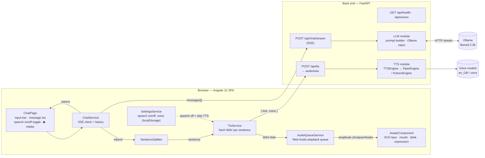

### Request flow for one turn

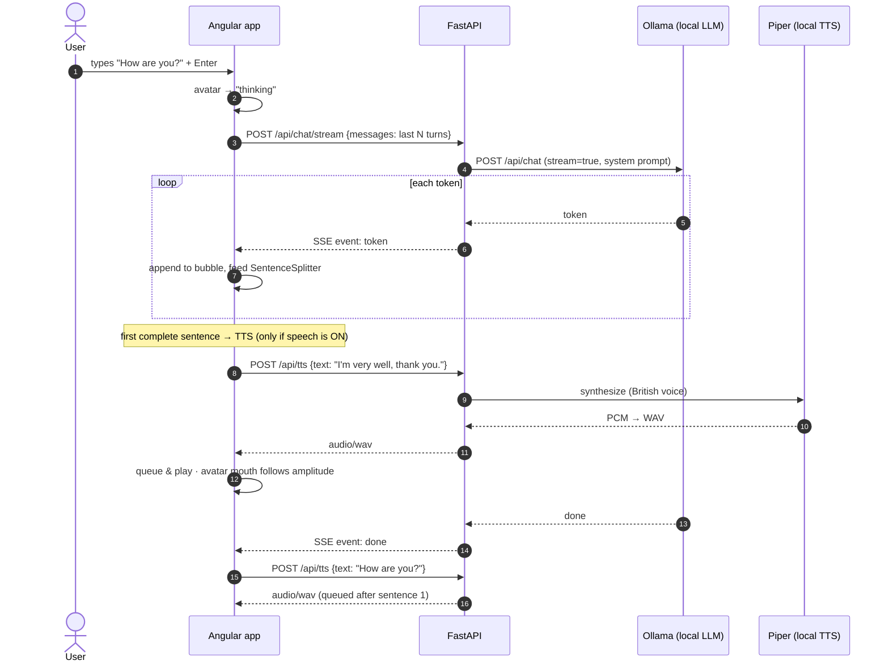

**Main design decision: text and speech use separate endpoints.**

- **Speech off** means the browser never calls `/api/tts`, so it costs nothing.
- **Replay (▶)** reuses the cached WAV blobs for that message, so the server is not called again.
- Speaking **one sentence at a time** means audio starts while the LLM is still writing.
  This is the same idea as the `StreamChunker` in *Speech-to-Speech-model/02*.
- The back end is **stateless**: the browser sends the last N turns on each request. This is
  easy to scale and needs no Redis for a prototype.

### Front-end structure

```
frontend/src/app/
  core/                         logic, no UI (unit-tested with Vitest)
    api.service.ts              fetch client: /api/chat/stream (SSE), /api/tts, /api/health, /api/voices
    sse-parser.ts               incremental SSE parser (fetch, because EventSource cannot POST)
    sentence-splitter.ts        token stream → sentences (decimals, "Dr.", "e.g.", initials, long runs)
    conversation.service.ts     orchestrator: stream reply, speak per sentence, per-voice audio cache,
                                stop, retry, sessionStorage history
    audio-player.service.ts     Web Audio queue (order-preserving), AnalyserNode → lip-sync level
    settings.service.ts         speech on/off, voice, theme (localStorage)
    status.service.ts           polls /api/health, loads voices
    expression.ts               reply tone → avatar expression (rule-based)
  ui/
    avatar.*                    SVG face: mouth from live loudness, blink, brows, gaze, head bob
    conversation.*              message list, ▶/■ per reply, starters, composer (Enter / Shift+Enter)
    settings-panel.*            brand, new conversation, voice picker + preview, speech switch, theme, status
    icon.ts                     one outline icon set
  app.*                         shell: sidebar frame, white sheet, greeting, 4/8 grid, phone top bar + sheet
frontend/e2e/                   Playwright tests against the real backend (desktop + phone)
```

**Design.** Built with the *tasteskill* app-screen rules (style "editorial greeting", dealt by its
`draw.mjs`): a warm tinted frame around a white sheet, tonal panels, one near-black pill primary,
and a deep-teal accent kept under 2% of the screen (the voice-level meter and focus). Instrument
Sans throughout, Instrument Serif only for the greeting. Fonts are self-hosted, so the app makes no
CDN calls. Checked with the skill's `lint.mjs --app` (0 FAIL, 0 WARN) and `inspect.mjs --app` at
1440/768/390 (0 FAIL, 1 WARN kept on purpose: the 48px serif greeting is the style's signature).

### Back-end structure

```
backend/app/
  main.py                     FastAPI app, CORS, lifespan (warm up LLM, load the voice once)
  config.py                   pydantic-settings: OLLAMA_URL, LLM_MODEL, TTS_ENGINE, VOICE…
  api/
    chat.py                   POST /api/chat/stream (SSE)
    tts.py                    POST /api/tts, GET /api/voices
    health.py                 GET /api/health (checks Ollama and the voice)
  llm/
    base.py                   class LLMAdapter(Protocol): stream_chat, chat, health, warm_up
    ollama_adapter.py         async httpx streaming client for Ollama
    prompt.py                 system prompt: persona rules + style example
    context.py                token budget and chunked history trimming (§4)
    postprocess.py            removes markdown and emoji, keeps spoken style
  stt/                        optional voice input (§8)
    whisper_engine.py         faster-whisper base.en, loaded once
  tts/
    base.py                   class TTSEngine(Protocol): synthesize(text, voice) -> bytes
    piper_engine.py           PiperVoice loaded once, synthesizes in a thread pool
    kokoro_engine.py          optional
    normalise.py              text cleanup for speech: "£5" → "five pounds", "Dr" → "Doctor"…
scripts/download_voices.sh    fetches en_GB voices from rhasspy/piper-voices (Hugging Face)
```

### API contract

| Method | Path | Request | Response |
|---|---|---|---|
| POST | `/api/chat/stream` | `{ "messages": [{ "role": "user", "content": "How are you?" }] }` | `text/event-stream`: `event: token` / `data: {"t":"I'm"}` … `event: done` |
| POST | `/api/chat` | same | `{ "reply": "I'm very well, thank you. How are you?" }` (non-streaming fallback) |
| POST | `/api/tts` | `{ "text": "...", "voice": "en_GB-cori-high" }` | `audio/wav` |
| GET | `/api/voices` | – | `[{ "id": "en_GB-cori-high", "label": "Cori (F, UK)" }, …]` |
| GET | `/api/health` | – | `{ "llm": "ok", "tts": "ok", "model": "llama3.2:3b" }` |
| POST | `/api/stt` *(optional, §8)* | `multipart/form-data` with `audio` (webm/wav) | `{ "text": "how are you" }` |

---

## 3. LLM architecture

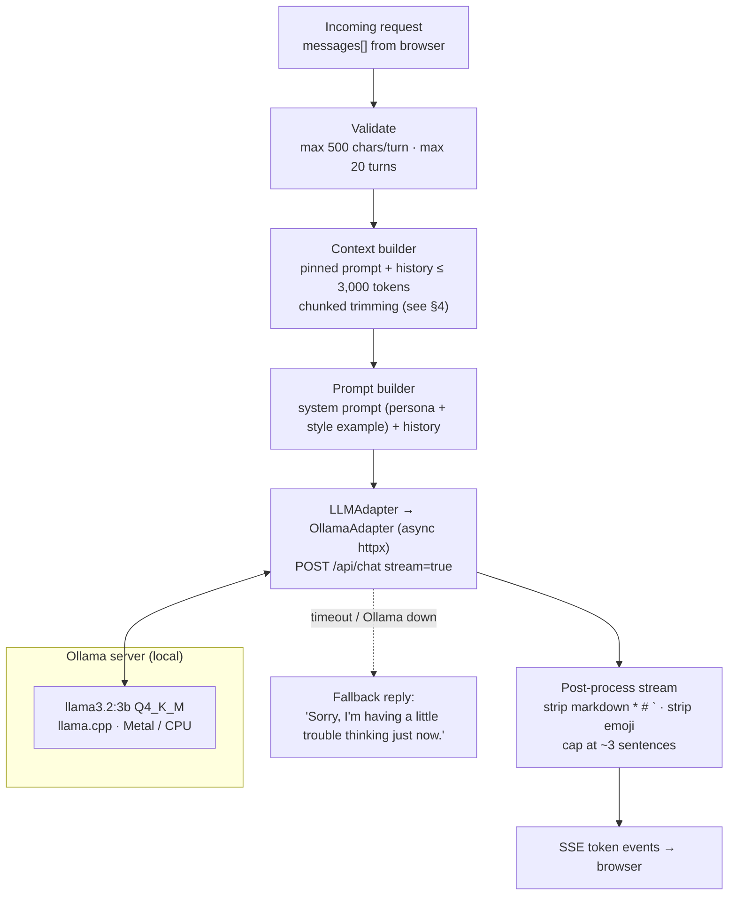

### Prompt design (what makes the replies sound British and spoken)

The whole prompt is **one system message** (`backend/app/llm/prompt.py`). The style example
sits inside it and is labelled as a style guide:

```text
You are Ellie, a warm, friendly conversational partner from England.
Speak naturally, as in a relaxed spoken conversation.
- Use British English spelling and expressions (colour, cheers, brilliant), and vary your
  wording rather than repeating the same words such as "lovely".
- Keep replies short: one to three sentences.
- Plain text only: no markdown, lists, emoji or stage directions.
- Respond to small talk warmly and naturally; if asked how you are, say you are very well, thank you.
- You are an AI, so never claim to have done things, been places or have a home, family or daily routine.
- Be honest if you are unsure about facts.
- Usually end with a friendly question to keep the conversation going.

Example of the tone and length to aim for (a style guide only, not part of this conversation):
User: What did you get up to at the weekend?
Ellie: Oh, I don't really have weekends, being an AI, but I'd love to hear about yours.
Did you get up to anything nice?
```

**How we got here.** We ran three rounds of prompt testing against the real model, sampling
each prompt several times because replies vary:

| Version | Problem found | Fix |
|---|---|---|
| v1: brief's `"How are you?"` pair given as fake earlier turns | A real "How are you?" got *"Same as last time!"* | Use a different example |
| v2: `"Good morning!"` pair as fake earlier turns | Greetings treated as repeats: *"Hello again!"*, *"Morning again!"* (3 of 24 replies). Robotic or invented small talk. | Move the example **into the system prompt**, labelled as a style guide |
| **v3 (current)** | **0 of 36** repeats, 0 robotic replies. "How are you?" gets *"I'm very well, thank you for asking…"*, almost the brief's example. | The example shows how to be honest about being an AI *and* warm |

Two lessons worth noting:
1. Small models take example turns given as earlier conversation **literally, as history**.
2. An instruction alone ("don't invent experiences") makes replies robotic. One example of the
   desired behaviour works better.

Regression tests in `tests/test_e2e.py` check greetings are not treated as repeats (sampled
several times) and that small talk is neither robotic nor invented.

**Known limit:** a 3B model can still state facts wrongly with confidence (for example a slightly
wrong London "fun fact"). That's fine for a conversational demo. It is the main argument for a
bigger model or retrieval (RAG) in a production system.

### Generation settings

| Option | Value | Reason |
|---|---|---|
| `temperature` | 0.7 | Natural without wandering |
| `top_p` | 0.9 | |
| `num_predict` | 160 | Replies stay short and suitable for speech |
| `num_ctx` | 4096 | Always set explicitly. About 20–30 short turns, ~0.45 GB KV cache (see §4) |
| `repeat_penalty` | 1.1 | Fewer loops in small models |
| `keep_alive` | `"30m"` | No cold start between turns |
| `think` | `false` | Turns off reasoning traces on Qwen models |

### Model options and fallback

Set by `LLM_MODEL`. All of these are pulled with `ollama pull <name>`:

- **Server with GPU or a Mac** → `llama3.2:3b` (default) or `qwen3.5:4b`
- **CPU-only VPS, 4–8 GB RAM** → `llama3.2:1b`

---

## 4. Context window and conversation memory

### Why we limit the context on purpose

`llama3.2:3b` supports up to 128K tokens of context, but Ollama only uses a small window unless
`num_ctx` is set. When a conversation grows past that window, Ollama **quietly cuts off the oldest
tokens**. Without our own trimming, that can cut the system prompt, and the persona disappears.
A bigger window also costs memory. The KV cache takes about **112 KB per token** for this model
(28 layers × 8 KV heads × 128 head dim × K and V × fp16):

| `num_ctx` | KV cache memory | Verdict |
|---|---|---|
| **4,096** | **~0.45 GB** | **Chosen.** Plenty for conversational chat. |
| 32,768 | ~3.7 GB | Not needed. Prompt processing is slower when the cache is missed. |
| 131,072 | ~14.7 GB | Too much for a small server, and a 3B model gets less coherent this long. |

### Measured: prompt caching matters (M3 Pro, ~2,500-token history)

| Request | Prompt processing | Total reply time |
|---|---|---|
| First request (no cache) | 4.39 s (~580 tok/s) | 6.26 s |
| Same history again (prefix cached) | **0.02 s** | **0.89 s** |

Ollama reuses its KV cache when **the start of the conversation is unchanged**. So the trimming
strategy is designed to keep the start the same for as many turns as possible.

### Token budget (per request)

```
┌──────────────────────────────────────────────────────────────┐ num_ctx = 4,096
│ PINNED   system prompt: persona + style example   ~300 tok  │ never dropped
│ PINNED   memory summary (optional, Tier 3)         ≤150 tok  │ updated rarely
│ HISTORY  recent user/assistant turns             ≤3,000 tok  │ trimmed in chunks
│ REPLY    reserved for generation (num_predict)     ~200 tok  │
│ MARGIN   token-estimate safety margin              ~500 tok  │
└──────────────────────────────────────────────────────────────┘
```

Ellie's replies are 1–3 sentences, so 3,000 tokens of history holds about **20–30 turns**.

### Trimming algorithm (`backend/app/llm/context.py`)

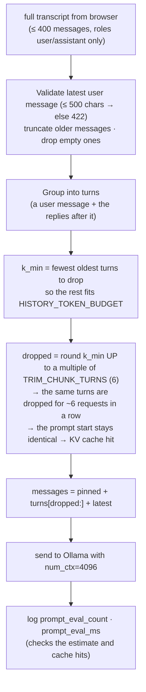

Because the backend keeps no state, `dropped` is a **pure function of the transcript**. Two
consecutive requests from the same conversation give the same answer until the history grows past
the next chunk boundary. No session storage is needed for cache-friendly trimming.

**Measured end to end** (real `/api/chat`, 60–67-turn conversation, M3 Pro):

| Turn | Turns dropped | Prompt tokens | Prompt processing | Total |
|---|---|---|---|---|
| 61 | 18 (trim) | 2,848 | 4,368 ms | 5.4 s |
| 62–66 | 18 (same) | 2,910–3,158 | **~182 ms** | **~1.4 s** |
| 67 | 24 (trim) | 2,848 | 4,387 ms | 6.1 s |

Five of every six turns hit the cache, so they are about 24× faster at prompt processing.
Below about 45 turns nothing is ever dropped, so every turn after the first hits the cache.

- **Token estimate:** `ceil(chars / 4) + 4` per message. Cheap and slightly cautious, and the
  500-token margin absorbs any error. We check it against Ollama's real `prompt_eval_count` in the logs.
- **Whole turns only:** a user message is never kept without its reply, or the other way round.
- **The latest user message is always kept,** even if it is long (it is already capped at 500 chars).

### Who holds the conversation

| Where | What | Why |
|---|---|---|
| **Browser** (`ChatService` signal + `sessionStorage`) | Full transcript for display | Survives a page refresh. "New conversation" clears it. |
| **Request body** | The whole transcript (≤ 400 messages, a few hundred KB at most) | The backend needs the full history to trim the same way every time. If the front end sent only the "last N", the start would change on every turn. |
| **Backend** (`context.py`) | Final validation and token-budget trimming | Does not trust the client. The backend keeps no state, so no database. |

### Rolling memory summary (Tier 3, built)

When turns are dropped, a **background** LLM call (after the reply has been sent) shrinks them into
a ≤60-word note, for example *"The user is Priyanka; her spaniel is called Biscuit."* The front end
keeps it and sends it back with each request, so the backend stays stateless. The note goes in the
pinned part of the prompt. Ellie remembers key facts from long conversations without a larger
window, and because the summary changes rarely, it doesn't break the cache.

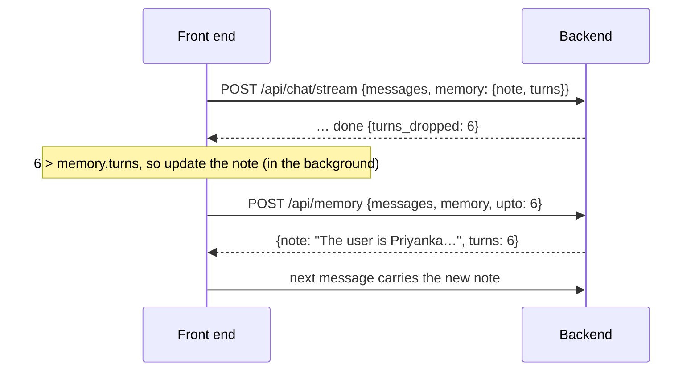

- `memory.turns` records how many of the oldest turns the note covers, so only **new** dropped
  turns are folded in (`backend/app/api/memory.py`). The note is used only while turns are
  actually dropped.
- It is generated cool and short (temperature 0.2, at most 120 tokens) with its own instruction:
  third person, facts only, never invent.
- **Tested with the real model** (`test_rolling_memory_keeps_facts_from_dropped_turns`): after 70
  filler turns push the introduction out of the window, Ellie cannot answer "what's my name and my
  dog's name?" without the note, and answers both with it.

### Configuration

```env
NUM_CTX=4096
HISTORY_TOKEN_BUDGET=3000
MAX_USER_CHARS=500           # latest user message; older ones are truncated
MAX_ASSISTANT_CHARS=1000
TRIM_CHUNK_TURNS=6
OLLAMA_KEEP_ALIVE=30m        # model stays loaded, so the KV cache survives between turns
```

### Tests (`backend/tests/test_context.py`)

- The system prompt is always first, and the latest user message is always last.
- Turns stay paired and the history stays within budget.
- The number of dropped turns is always a whole number of chunks.
- At least 80% of consecutive requests share an identical prompt start.
- Invalid history is rejected: empty, not ending with a user message, or the latest message too long.

---

## 5. LLM adapters

"Adapter" can mean two things here. The design uses both.

### 5.1 Adapter pattern: swappable LLM back ends (core)

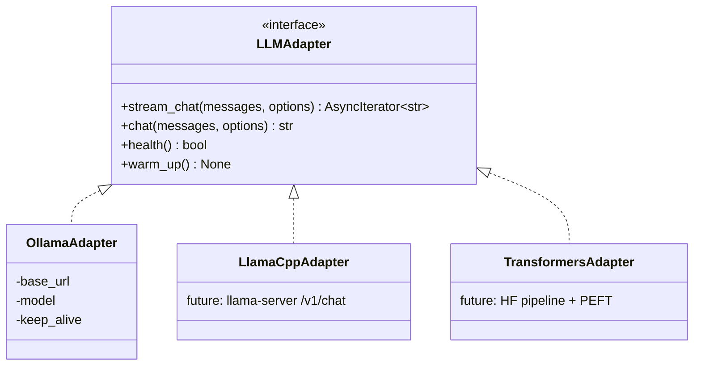

The rest of the backend (routes, context builder, post-processing) only talks to `LLMAdapter`.
`LLM_BACKEND=ollama` chooses the implementation, so changing runtime or model needs no code change.
`TTSEngine` follows the same pattern (§6).

### 5.2 LoRA adapter fine-tune (Tier 3, built: full write-up in [training/README.md](../training/README.md))

**The core app does not need it.** The prompt in §3 is enough for coherent British replies. The
adapter's job is to get the same behaviour, or better, from a **one-line prompt** (52 tokens
instead of 256), which also means a faster first word on a CPU server.

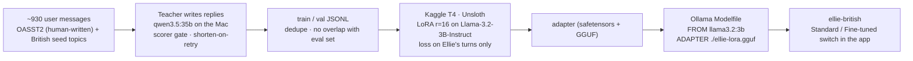

- **Measured, not assumed.** 40 held-out prompts × 3 samples, scored by explainable rules
  (`training/eval/score.py`), before and after training.
- **Same prompt format as at run time.** Training examples are built token by token in Ollama's
  llama3.2 template (it adds a "Cutting Knowledge Date" line and no date), not Hugging Face's.
- **In the app:** the backend accepts an optional `model` per message, only from an allow-list
  (`LLM_ALT_MODELS`). Models in `SHORT_PROMPT_MODELS` get the one-line prompt. `/api/health` lists
  the installed choices, and the settings panel shows the switch only when there are two.

---

## 6. TTS architecture

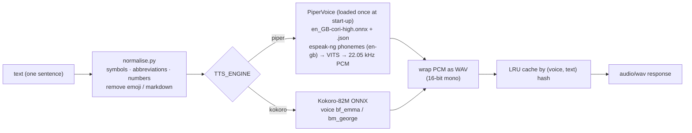

- The voice is **loaded once** at start-up. Synthesis runs in `run_in_threadpool` so it does not
  block the event loop.
- **Five regional English accents** from Piper's VCTK voice, one 77 MB model with 109 speakers
  (VCTK corpus, CSTR, University of Edinburgh, CC BY 4.0). Each speaker's home region is
  documented in the corpus's `speaker-info.txt` (checked against two independent copies). Within
  each region, the voice was picked by measured clarity (Whisper transcribed every test sentence
  word for word) and paced to about 225 words a minute:

  | Voice id | Region | Speaker | Gender |
  |---|---|---|---|
  | `uk-south` (default) | Southern England | p228 | female |
  | `uk-north` | Newcastle | p269 | female |
  | `uk-midlands` | Birmingham | p256 | male |
  | `uk-east` | Suffolk | p273 | male |
  | `uk-west` | South-West England | p239 | female |

  `VOICES` lists what the app offers (any other voice is refused); `/api/voices` feeds the picker.
- **Natural pauses** are added by the browser's audio player, so every engine gets them: about
  0.18–0.6 s between sentences depending on the punctuation and the sentence's length, ±15%
  variation, and a soft synthetic inhale before long sentences. Time spent waiting for the next
  clip counts towards the pause. Measured in Chrome: 355–497 ms on, 0 ms off.
- Piper settings to tune for naturalness: `length_scale` 1.0–1.1 (slightly slower),
  `noise_scale` 0.667, `noise_w` 0.8, and a short sentence pause.
- **Kokoro (Tier 3, built).** `TTS_ENGINE=piper+kokoro` puts both engines behind one `TTSEngine`
  (`multi_engine.py`). Each voice belongs to one engine (Kokoro ids start `kokoro-`), and a request
  is routed by its voice, so switching engine in the app is just picking a voice. Kokoro offers 8
  British voices (`bf_emma`, `bm_george`, …). We use the **int8** model: it is twice as fast as the
  full one (0.8 s for 4.8 s of audio on 3 CPU threads, against 1.6 s), and Whisper transcribed
  both word for word. Piper stays the default, because it is quicker still (~0.3 s per sentence).
  Kokoro uses the same CPU sharing as Piper (§10.2). Licences: Kokoro-82M weights Apache-2.0,
  `kokoro-onnx` MIT; its `phonemizer` dependency is GPL-3.0, like Piper 1.8 itself.
- What we reuse from *Speech-to-Speech-model/02* (`src/tts/tts_manager.py`): the idea of
  per-engine routing with fallback. Here we use the Piper **Python API** instead of calling the
  CLI as a subprocess, which saves about 100–300 ms per call.

---

## 7. Avatar (optional enhancement)

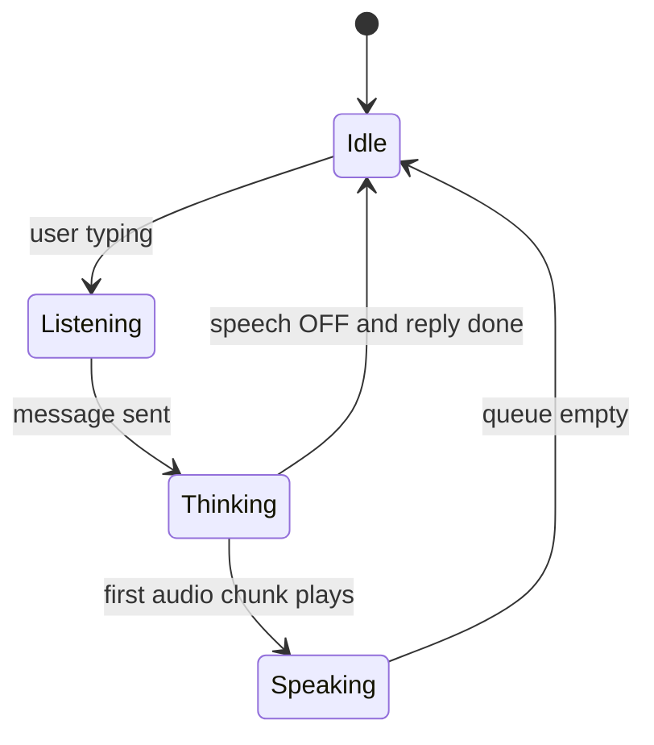

- **Lip-sync:** `AnalyserNode.getByteTimeDomainData()` → RMS → smoothed → `mouthOpen` (0..1),
  updated in `requestAnimationFrame`. The mouth is an SVG path whose height and width follow
  `mouthOpen`. This stays in sync with the real audio at any speed and with any voice.
- **Expressions:** brows, eyes and mouth curve per state (idle smile, thinking eyes looking up,
  speaking). A small rule-based sentiment check on the reply (keywords and punctuation) adds
  *happy* and *concerned* variants.
- **Life-like touches:** random blinks every 2–6 s, a slight head bob while speaking.
- **Stretch goal:** phoneme-level visemes from Piper's phoneme output. We would only try this
  once everything else works.

---

## 8. Voice input — "listening" (optional enhancement)

### Is this a speech-to-speech system?

**No. The brief asks for text in and text plus speech out.** It says *"Provide a text input field"*,
and the example input is marked *[written]*. So the required pipeline is:

```
typed text ──▶ LLM ──▶ written reply + spoken reply (TTS)
```

A *speech-to-speech* system also **listens** (speech recognition) before the LLM. That would be
**ASR → LLM → TTS** (a cascade, like our earlier *Speech-to-Speech-model/02*) or one end-to-end
audio model (like *apollo-engine*). Neither is required here. We build the required text-input
system first. Then, if time allows, we add a **push-to-talk microphone button** that feeds the
same pipeline. The text box stays the main input, as the brief asks.

### Design (keeps the "everything local" rule)

**Built (Tier 3).** Click the 🎤 to record and click again to finish (Escape discards the
recording). Whisper `base.en` (int8, a third of the CPU cores) transcribed 5.3 s of Piper speech
word for word in 0.55 s. The browser test plays a Piper recording into Chrome as its microphone
and checks the transcript and Ellie's answer, with no human involved.

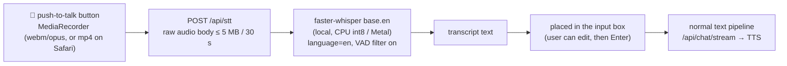

- **Why not the browser's built-in speech recognition (Web Speech API)?** In Chrome it sends
  audio to a cloud service, which goes against the "local" requirement. Local Whisper keeps
  everything on our server, and we already used it in *Speech-to-Speech-model/01*.
- **Model:** `base.en` (~140 MB, fast on CPU). `small.en` if accuracy needs a boost.
- **Transcript goes into the input box first:** the user can fix recognition errors before
  sending, and the "written input" flow in the brief stays as it is.
- **Avatar:** shows the *listening* expression while recording.
- **Barge-in:** pressing the mic stops any speech that is playing.

---

## 9. Whole-system diagram

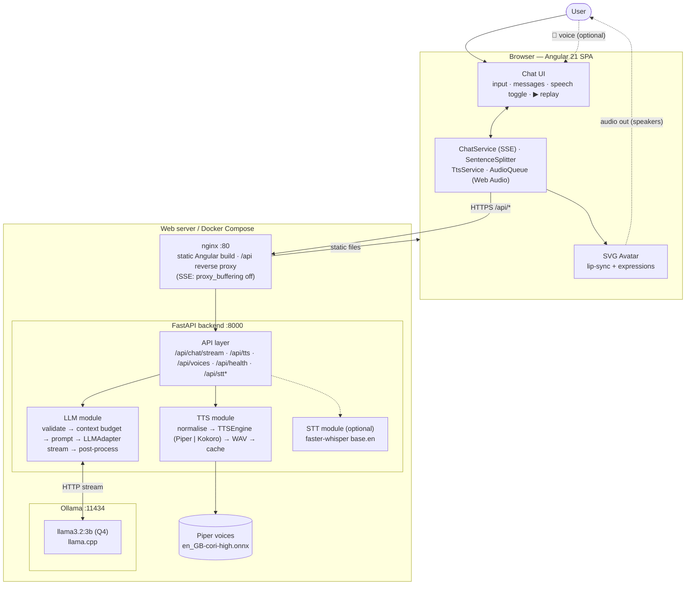

`*` and dashed lines = optional enhancement (§8).

---

## 10. Deployment

| Environment | How |
|---|---|
| **Local dev** | Ollama runs natively (uses the Metal GPU on Mac). `uvicorn app.main:app --reload`. `ng serve` with `proxy.conf.json` → `:8000`. |
| **Single port (simplest demo)** | `ng build`, then `uvicorn` alone: FastAPI serves the Angular build at `/` and the API at `/api` on port 8000 (it mounts `frontend/dist/frontend/browser` when it exists). |
| **Server** | `docker compose up -d --build` → `web` (nginx), `backend`, `ollama`, plus a one-off `ollama-pull` job that downloads the model into the `ollama-models` volume. On Linux with an NVIDIA GPU, uncomment the `deploy.resources` block. |
| **Mac with Docker** | `docker compose -f docker-compose.yml -f docker-compose.host-ollama.yml up -d --build`: `web` and `backend` in Docker, the model in the native Ollama app (Metal GPU), reached at `host.docker.internal:11434`. |
| **Demo link for submission** | Either (a) a small cloud VM running the compose stack, or (b) the dev machine exposed through a Cloudflare Tunnel during the review window. Both still count as a *locally running* model, because the model runs on our own host. |

On macOS, Ollama inside Docker cannot use the Metal GPU, which is why the override file exists.

### 10.1 Containers

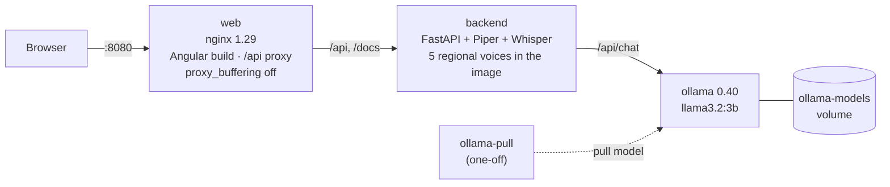

- Only `web` publishes a port. The backend and Ollama are reachable only inside the compose network.
- Start order is enforced by health checks: `ollama` healthy → `ollama-pull` finished → `backend`
  healthy → `web`.
- Images: backend ~1.2 GB (Python, onnxruntime, Whisper, 77 MB of voices), web ~93 MB. The model adds ~2 GB
  in the volume.
- The frontend image builds with Node 24 (npm 11), so `npm ci` reads the lock file as it was written.

### 10.2 Sharing the CPU between the LLM and Piper

On a CPU-only host, both engines start one thread per core by default, and onnxruntime (Piper)
threads spin-wait between jobs. Measured in Docker on 11 cores, the model wrote 20–40 tokens per
second on its own but only 0.7–3 tokens per second while Piper was speaking the previous sentence,
and with default settings a reply did not finish at all. Since speech always overlaps generation
(§6), this made the CPU-only deployment unusable.

The fix gives each engine a share of the cores. The LLM gets half (`num_thread`, sent with every
Ollama request). Piper gets a third (its own ONNX session with `intra_op_num_threads` set and
spinning off). With that, the model keeps 26–38 tokens per second while speech is made, and the
full browser test suite passes against the CPU-only stack in about 32 s. Both are automatic and
can be overridden with `LLM_NUM_THREAD` and `TTS_THREADS`. On the Mac GPU the thread limit makes
no measurable difference.

## 11. Non-functional notes

- **Latency budget (warm, M3 Pro):** first token about 0.3 s, first sentence about 0.6 s,
  Piper for one sentence about 0.1–0.2 s, so the voice starts about 1 s after Enter.
- **Robustness:** health checks, a timeout on the Ollama stream, a friendly fallback message,
  and the UI still works with speech off if TTS fails.
- **Security:** input length limits, CORS restricted to the front-end origin, no secrets needed.
  The LLM and TTS are only reachable through the backend.
- **Testing:** pytest for prompt building, post-processing and normalisation, plus TTS returning
  a valid WAV. Angular unit tests for the sentence splitter and audio queue.

## 12. Features and delivery plan (deadline 23 Nov, 17:00)

### Tier 1: required by the brief (must work)

1. Chat interface (Angular): text input (Enter to send), message list, "thinking…" indicator
2. Local LLM replies (`llama3.2:3b` via Ollama) with a British persona prompt
3. Streaming text (token by token over SSE)
4. Spoken British English reply (local Piper voice `en_GB-cori-high`)
5. Speech on/off toggle (remembered between visits; when off, no audio is generated)
6. ▶ Play button on every reply (replays cached audio)
7. Conversation memory: token-budgeted context window (§4)
8. Install and run guide (README) and `docker compose up`

### Tier 2: what makes the demo stand out

9. Speech starts after the first sentence (~1 s after Enter)
10. Animated SVG avatar: audio-driven lip-sync, blinking, expressions
11. Voice picker (2–3 UK voices)
12. `LLMAdapter` / `TTSEngine` interfaces (swappable back ends)
13. Health indicators and graceful fallbacks
14. Stop button, New conversation, light and dark mode, works on mobile

### Tier 3: stretch goals (only after everything above)

15. ✅ LoRA adapter fine-tune ("British Ellie") with a base vs adapter switch (§5.2, [training/](../training/README.md))
16. ✅ Kokoro TTS engine option, alongside Piper (§6)
17. ✅ Push-to-talk voice input with local Whisper (§8)
18. ✅ Rolling memory summary for long conversations (§4)

### Day-by-day plan

| Day | Work | Done when |
|---|---|---|
| **Wed 19** | Set up the repo. Backend `/api/chat`, `/api/chat/stream`, `/api/tts`, `/api/health`. `OllamaAdapter`, `context.py`, British prompt, Piper voice and listening test. | `curl` returns a British reply and a WAV file that plays |
| **Thu 20** | Angular: chat UI, SSE streaming, speech toggle, ▶ replay, sentence-by-sentence audio queue, `sessionStorage` history | Features 1–9 work end to end |
| **Fri 21** | Avatar, voice picker, Stop/New, error handling, UI polish | Features 10–14 done. **Core app frozen.** |
| **Sat 22** | Docker Compose and nginx, deploy the demo link, README and docs. Tier 3 if time allows. | Public link works from a phone |
| **Sun 23** | Buffer: test on a fresh machine, record a backup demo video, prepare talking points. **Email the link well before 17:00.** | Submitted |

Ground rules: required features always come first (Tier 3 gets dropped, never Tier 1),
commit to GitHub at the end of every day, and no new features after Friday night.
