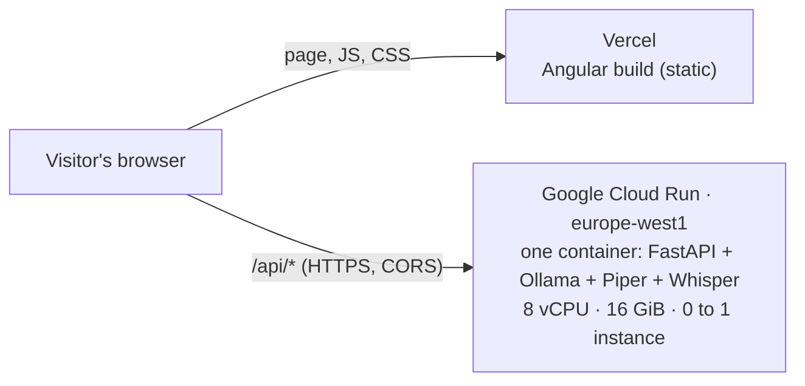

# Deployment: how the live demo runs

**Live:** [ellie-rosy.vercel.app](https://ellie-rosy.vercel.app) · Back to the [README](../README.md)

The model still runs on *our own* server, not a cloud AI service: the same `llama3.2:3b`, Piper and
Whisper as on a laptop, in one container that we control.



## Why this split

| Need | Choice | Reason |
|---|---|---|
| Serve the Angular app | **Vercel** | Static files on a CDN, free, HTTPS, rebuilds in about a minute |
| Run a 3B model, TTS and STT | **Cloud Run** | Runs our own container. **Scales to zero**: billed only while a request is being served, so an idle demo costs nothing |
| Keep it simple | One container | Ollama, the model, the voices and Whisper are all built into the image, so a new instance needs no downloads |

A GPU would make replies faster, but would cost money every hour whether used or not. For a demo
that is mostly idle, CPUs that scale to zero are the better trade.

## The backend on Cloud Run

| Setting | Value | Why |
|---|---|---|
| Image | [`deploy/cloudrun/Dockerfile`](../deploy/cloudrun/Dockerfile) | Three stages: build the frontend, take the Ollama binary (CPU only), then Python + the model, voices, Whisper, and the OpenVoice v2 converter with CPU-only PyTorch for Use my voice |
| Size | 8 vCPU, 16 GiB | The model writes about 5 words a second on 5 threads, about twice as fast as speech |
| Instances | min 0, max 1 | Scales to zero; one instance at most caps the cost |
| CPU split | `LLM_NUM_THREAD=5`, `TTS_THREADS=3`, `STT_THREADS=1` | Speech is made while the model is still writing, so each engine gets a fixed share ([ARCHITECTURE §10.2](ARCHITECTURE.md#102-sharing-the-cpu-between-the-llm-and-piper)). With 7/1, a long sentence could take 5 s to synthesise during writing and leave a silence; with 5/2 every gap measured stayed under 0.75 s. Speech threads went to 3 for Use my voice (Piper plus the converter): with short pieces, measured gaps in a cloned voice stayed under 0.7 s (one 1.1 s), with the voice starting at about 5 s |
| `CORS_ORIGIN_REGEX` | `https://ellie[a-z0-9-]*\.vercel\.app` | Only the Vercel frontend may call the API from a browser |
| `API_DOCS` | `false` | No public API map |
| Start-up | [`start.sh`](../deploy/cloudrun/start.sh) | Starts Ollama, waits for it, then uvicorn on `$PORT` |

**Cold start.** When nobody has used it for a while (up to about 15 minutes), the instance stops. The next visitor
waits while it starts and loads the 2 GB model into memory; the frontend shows *"Waking Ellie
up…"* and waits for up to 90 seconds. Every later request is fast.

### Build and deploy

The image is built on Cloud Build (no local Docker needed):

```bash
gcloud builds submit --config deploy/cloudrun/cloudbuild.yaml --region=europe-west1 --substitutions _IMAGE=europe-west1-docker.pkg.dev/<PROJECT_ID>/ellie/ellie:<TAG> .
```

```bash
gcloud run deploy ellie --image=europe-west1-docker.pkg.dev/<PROJECT_ID>/ellie/ellie:<TAG> --region=europe-west1 --cpu=8 --memory=16Gi --min-instances=0 --max-instances=1 --cpu-boost --execution-environment=gen2 --set-env-vars=LLM_NUM_THREAD=5,TTS_THREADS=3,STT_THREADS=1,API_DOCS=false --allow-unauthenticated
```

`CORS_ORIGIN_REGEX` is set the same way (it contains commas and backslashes, so set it on its own
with `--update-env-vars`).

## The frontend on Vercel

The Vercel project's root is `frontend/`. [`vercel.json`](../frontend/vercel.json) runs
`node scripts/write-config.mjs && npx ng build`: the first step writes `config.js` from the
`ELLIE_API_BASE` environment variable, so the same build works locally (empty: same origin) and
on Vercel (the Cloud Run URL). It also sets the security headers, including a Content Security
Policy that lets the page talk only to itself and the Cloud Run API.

```bash
cd frontend && vercel deploy --prod
```

The backend's address is public by nature: every browser has to know where to send requests.
What protects it is described in [SECURITY.md](SECURITY.md).

## Cost

Cloud Run bills only while a request is in flight (scale to zero), at about **$0.84 per hour of
use** for 8 vCPU and 16 GiB. The monthly free tier covers the first ~6 hours of use. The hard
limits in [SECURITY.md](SECURITY.md) keep the worst case under about $20 a day, and a budget alert
emails the owner well before that.

| Usage | Approximate cost |
|---|---|
| Idle | $0 |
| A reviewer's 20-minute session | under $0.30 |
| Busy all day (the ceiling) | about $20 |

## Monitoring

[`deploy/cloudrun/status.py`](../deploy/cloudrun/status.py) prints a one-screen report from Cloud
Logging: requests by endpoint and status, response times, rate-limited requests, errors, reply
timings and cold starts. It never shows what people typed: the app does not log messages.

```bash
python3 deploy/cloudrun/status.py --hours 24
```

```text
== Ellie on Cloud Run: last 24 h
size 8 CPU / 16Gi  instances 0..1

-- requests: 349
    161  GET     /api/health          200   median 0.01s
     41  POST    /api/tts             200   median 0.43s
     16  POST    /api/chat/stream     200   median 8.51s
     16  POST    /api/chat            200   median 1.94s
      6  POST    /api/chat            429   median 0.00s
      3  POST    /api/stt             200   median 2.01s
     ...
-- rate-limited requests: 6
-- errors: 0
-- replies: 32, median 4.2s, slowest 31.2s
-- cold starts (instance start-ups): 7
```

(A real report from the first day, which includes the security tests: the 429s are the rate
limit working. A streamed reply is timed until the last word, so it includes the whole answer.)

The same data is in the Google Cloud console under Cloud Run → `ellie` → Metrics and Logs.

## Taking it down

```bash
gcloud run services delete ellie --region=europe-west1
```

Deleting the Google Cloud project removes the service, the images and the logs together.

## Standard + v2 comparison release

The comparison release keeps `llama3.2:3b` as the default and adds `ellie-british` (v2).
`ellie-british-v3` stays experimental and is not bundled. Both models use the same Piper
voices. The **Compare models** view provides:

- The recorded 40-prompt × 3-sample local evaluation, exported from the saved raw records
  with `backend/.venv/bin/python training/eval/export_demo.py`. Facts and name recall are
  separate columns; these are small expected-answer checks, not general accuracy estimates.
- A fresh live message sent to each model in isolation, with the same seed. **Same one-line
  prompt** compares model weights under the same instructions; **App prompts** compares
  Standard's detailed style prompt against v2's learned style and short prompt.
- Independent reply cards, word/input-token counts, browser-observed first-text/full-reply
  times, and playback in the selected voice. Requests are sequential and their order alternates.
  Timings can include model loading; they are observations, not a speed benchmark. The normal
  app cleanup still applies to live text, whereas recorded scores use raw output.

The API accepts only the two server-owned prompt styles and a bounded integer seed; the
model allowlist, message limits and generation rate limits still apply. Comparison history
is never added to the user's saved conversation or memory. Health reports `comparison.version`
so a newer frontend cannot silently claim a same-prompt comparison against an older backend.

### Build

`Dockerfile.comparison` extends the **digest-pinned v5 production image**, preserving its
working dependencies, base model and speech models. It replaces the frontend/backend code
and imports the checksummed v2 GGUF into Ollama. The temporary bind mount avoids keeping
another raw GGUF copy in an image layer ([Docker build guidance](https://docs.docker.com/build/building/best-practices/#add-or-copy)).
Cloud Build receives `DOCKER_BUILDKIT=1` through its build-step environment
([Cloud Build schema](https://cloud.google.com/build/docs/build-config-file-schema#env)).
For a future dependency update, build a new full image with the main Dockerfile, then update
`_BASE_IMAGE` to its verified digest.

```bash
python3 deploy/cloudrun/prepare_comparison.py
backend/.venv/bin/python training/eval/export_demo.py
gcloud --configuration=ellie --project=ellie-tts-1123f2b4 builds submit \
  --config=deploy/cloudrun/cloudbuild-comparison.yaml --region=europe-west1 \
  --substitutions=_IMAGE=europe-west1-docker.pkg.dev/ellie-tts-1123f2b4/ellie/ellie:comparison-v2-20261124 .
```

The preparer verifies v2's SHA-256 before copying it into the build folder. The GGUF remains
ignored by git. `.gcloudignore` allows only that exact model filename and excludes training,
research, environment files and interview preparation. While this model is staged, other
Cloud Build submissions from this checkout also include it; remove the staged copy when
returning to base-only builds.

### Roll out and verify

Deploy the new image first with `--no-traffic --tag comparison-v2`, preserving the current
service's CPU, memory, CORS and rate-limit configuration. Set `LLM_MODEL=llama3.2:3b`,
`LLM_ALT_MODELS=["ellie-british"]`, `SHORT_PROMPT_MODELS=["ellie-british"]`,
`OLLAMA_MAX_LOADED_MODELS=2` and `OLLAMA_NUM_PARALLEL=1`. Keep min instances at zero.
Verify the tagged revision's health lists both models and run a paired text/voice smoke test
before moving production traffic. Deploy the matching frontend to Vercel afterwards.
Retain the previous revision as a rollback target.

### Verified release: 24 November 2026

Production uses revision `ellie-00010-kav` and image digest
`sha256:fb4f7c898fbbf6aec870328c9d8355cd138c95821835a8d521816b87b6bc9f82`.
Both the preview revision and public Vercel URL passed matched-message text and speech
checks. The public site also passed the normal App prompts mode. Standard remains the
default, both Standard and v2 are offered, and v3 is not deployed. The previous revision is
`ellie-00009-6tx`.

See the [release record](../deploy/cloudrun/releases/2026-11-24-comparison-v2.json) and
[public App prompts check](../deploy/cloudrun/releases/comparison-v2-production-app-smoke.json).
Recorded observations are single smoke-test runs, not a new aggregate benchmark.
The temporary local build copy of the GGUF was removed after the successful build; its
original training artifact remains available for `prepare_comparison.py`.

```bash
node deploy/cloudrun/smoke-comparison.cjs https://ellie-rosy.vercel.app /tmp/comparison.json /tmp/comparison.png short
node deploy/cloudrun/smoke-comparison.cjs https://ellie-rosy.vercel.app /tmp/app-prompts.json /tmp/app-prompts.png default
```
