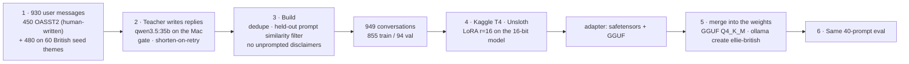

# Fine-tuning Ellie: a LoRA adapter for `llama3.2:3b`

Tier 3, item 15 ([ARCHITECTURE.md §5.2](../docs/ARCHITECTURE.md)). The app works without it.

## Why

Today Ellie's behaviour comes from a **256-token system prompt** full of rules. That has two costs:

1. **It still leaks.** With the full prompt, only 60% of replies pass every check. A third are too
   long to listen to comfortably, and some sound robotic ("I'm just a computer programme").
2. **It is slow on a CPU server.** Those 256 tokens are processed for every new conversation.

**The goal of the adapter:** the model behaves like Ellie with a **one-line prompt (52 tokens)**,
and behaves *better* than it does today with the long one.

## Baseline (measured before any training)

40 fixed prompts × 3 samples = 120 replies per row, with the app's sampling settings.
Scored on the raw model output by [`eval/score.py`](eval/score.py).

| Setup | Prompt tokens | Clean | Too long | Robotic | American | Lists/markdown | Invented life | Cut off | Known answers | Avg words |
|---|---|---|---|---|---|---|---|---|---|---|
| `llama3.2:3b` + full prompt (**the app today**) | 256 | 60% | 33% | 8% | 1% | 0% | 0% | 0% | 100% | 45 |
| `llama3.2:3b` + one-line prompt | 52 | **1.7%** | 98% | 2% | 10% | 14% | 7% | 35% | 100% | 90 |
| `qwen3.5:35b` + full prompt (**the teacher**) | 259 | **94.2%** | 2% | 1% | 0% | 0% | 0% | 0% | 100% | 38 |

**Target for the adapter, with the one-line prompt:** clean ≥ 85%, too long ≤ 10%, robotic ≤ 2%,
invented life 0%, known-answer matches still 100%.

## The pipeline



### 1. Evaluation set (`eval/`)

- [`eval/prompts.jsonl`](eval/prompts.jsonl): 40 prompts in 11 categories (small talk,
  invented-life traps, British vocabulary, advice, facts, format traps, feelings, numbers to
  speak, multi-turn memory, boundaries). 4 have known answers (Canberra, Austen, the Moon's
  distance, the user's name).
- **Held out:** training messages that resemble any of them (similarity > 0.8) are removed (6 were).
- [`eval/score.py`](eval/score.py): rule-based checks, each one traceable to the exact words that
  triggered it (10 unit tests). [`eval/run_eval.py`](eval/run_eval.py) runs a model and writes `results/`.

### 2. Dataset ([`data/`](data/build_dataset.py)): what the model learns from

| Part | Source | Why |
|---|---|---|
| **User messages** | (a) **450 real, human-written** opening messages from **OpenAssistant OASST2** (Apache-2.0): English, reviewed, low toxicity (< 0.05), 12–160 characters, no code. (b) **480 messages on 60 seed themes** written for this app ([`topics.py`](data/topics.py)): British everyday life, advice, facts and live-information questions, traps about Ellie's "life", format traps, feelings, numbers, boundaries. The teacher writes 8 varied messages per theme, typed the way people really type. | Real messages add the messy variety of how people write; themes cover what Ellie must handle. |
| **Ellie's replies** | Written by the **teacher, `qwen3.5:35b`**, locally (94.2% clean on the eval). Its prompt is the app's rules plus fixes for its own habits (below). | No hand-labelling; teacher inference runs locally. The resulting dataset is uploaded for training. |
| **Conversations** | 26% (247) are 2–3 turns: the teacher also writes the user's follow-up. | So follow-ups and memory keep working after training. |

**The quality gate, and what it caught.** Every reply must pass the scorer, be at most 55 words,
and avoid a few words. Reading the data turned up problems the first version of the pipeline let
through, each fixed in code rather than by hand:

| Problem found | How it was found | Fix |
|---|---|---|
| 25% of messages got no acceptable reply in 3 tries; almost all were just too long | rejection reasons logged per attempt | an over-long reply is no longer thrown away: the teacher is asked to say it again in at most 35 words. Failures dropped to 2% |
| 99% of replies ended with a question | build statistics | 35% of examples are told to end on a statement, and rejected if they don't: now 75% |
| 15% of replies said "I can't see live prices / today's news" when nobody had asked (*"How to cook Sindhi Biryani?"*) | reading samples by hand | the rule now applies only when the user asks about live information; an unprompted disclaimer is a rejection reason; those 135 were rewritten |
| "here in the cloud", "absolutely gut-wrenching" | reading the eval replies | banned in the gate |

**Final dataset** ([`data/out/stats.json`](data/out/stats.json)): 949 conversations, 855 train and
94 validation, 1,339 Ellie turns, 35.4 words per reply on average. Format: chat JSONL, each line
`{"messages": [system (the one-line prompt), user, assistant, ...]}`.

### 3. Training on Kaggle ([`kaggle/`](kaggle/run.sh))

`kaggle/run.sh` does it all from the Mac: uploads the data as a **private** dataset, pushes
[`kernel/train.py`](kaggle/kernel/train.py) as a **private** script on a **T4**, waits, and downloads
the output. The Kaggle key lives in its own folder, so the wrong account can never be used.

| Setting | Value |
|---|---|
| Base | `unsloth/Llama-3.2-3B-Instruct`: the same weights as Ollama's `llama3.2:3b`, no Hugging Face token needed |
| Method | LoRA with [Unsloth](https://github.com/unslothai/unsloth) on the **16-bit** model (it fits a T4's 16 GB, so no 4-bit quantisation is needed and the adapter matches the real weights) |
| LoRA | r = 16, alpha = 32, dropout 0, on all attention and MLP projections |
| Optimiser | AdamW, learning rate 1e-4, cosine, 5% warm-up, 2 epochs, best epoch kept by validation loss |
| Batch | 4 × 2 gradient accumulation; maximum sequence length 1,024 tokens |
| Loss | **on Ellie's turns only** (system and user tokens are masked) |
| Prompt format | built token by token in **Ollama's** llama3.2 template, which adds "Cutting Knowledge Date: December 2023" to the system turn and no date line, unlike Hugging Face's. Training on a different format from the one used at run time would waste part of what is learned |

**What the trial runs caught.** Kaggle's image now has Transformers 5.17, which removed
`warmup_ratio`. Warm-up is now computed in steps, and the script drops (and logs) any training
argument the installed version does not accept, so a renamed argument cannot fail a run.

### 4–6. Back on the Mac

```bash
training/kaggle/run.sh --fetch      # download the output of the last run
training/ollama/install.sh          # ollama create ellie-british from the merged Q4_K_M GGUF
backend/.venv/bin/python training/eval/run_eval.py tuned-short ellie-british --prompt short
```

In the app, the settings panel then shows **Model: Standard / Fine-tuned** (the backend sends the
one-line prompt to the fine-tuned model).

## Results

The final model (v2) with the **one-line prompt**, on the same 40 prompts × 3 samples as the
baseline (120 replies per row, [`eval/results/summary.json`](eval/results/summary.json)):

| Setup | Prompt tokens | Clean | Too long | Robotic | American | Lists/markdown | Invented life | Cut off | Known answers | Avg words |
|---|---|---|---|---|---|---|---|---|---|---|
| `llama3.2:3b` + one-line prompt | 52 | 1.7% | 97.5% | 1.7% | 10% | 14% | 6.7% | 35% | 100% | 90 |
| `llama3.2:3b` + full prompt (the app today) | 256 | 60% | 33% | 8.3% | 0.8% | 0% | 0% | 0% | 100% | 45 |
| **`ellie-british` + one-line prompt** | **52** | **86.7%** | **10%** | **0.8%** | **0%** | **0%** | **0%** | **0%** | 75% | **35** |
| `qwen3.5:35b` + full prompt (the teacher) | 259 | 94.2% | 1.7% | 0.8% | 0% | 0% | 0% | 0% | 100% | 38 |

- With a fifth of the prompt, the fine-tune is **far cleaner than the base model with its full
  prompt** (86.7% vs 60%) and close to the 35B teacher that wrote its training data: short,
  spoken, British, no lists, never pretending to have a life.
- **The cost:** 3 of the 12 known-answer checks failed (75% matched), where the base model got all 12. This small check
  shows a regression in the saved replies, not its cause. v2 halved the learning rate and
  trained for 2 epochs instead of 3 after v1's validation loss rose after epoch 1 ([`results/`](results/)).
- It met the targets for length, robotic replies and invented life, and exceeded the clean-reply target
  (86.7%, target 85%). The factual-answer target remains unmet.

**Training runs.** Both runs used a T4 GPU. The final one ran on Google Colab, driven from the command line
([`colab/`](colab/)): LoRA r = 16 at learning rate 1e-4 for 2 epochs, about 7 minutes. Ollama 0.40
no longer loads separate LoRA adapters, so the adapter is merged into the weights and quantised to
Q4_K_M with llama.cpp, like the base model ([`ollama/install.sh`](ollama/install.sh)).

## v3: corpus-guided training data

The [corpus comparison](../research/README.md) found that v2 overuses *lovely* and
*brilliant* while rarely using *yeah*, *you know* or tag questions. v3 changes assistant
replies in the existing 855/94 train/validation split; all user and system turns stay the same.
The Spoken BNC2014 remains local: only aggregate feature rates guide the rewrites, and no
corpus text is included in the uploaded data.

[`data/corpus_style.py`](data/corpus_style.py) runs four stages:

1. The local teacher writes three candidate rewrites per assistant reply. Rule-based guards
   check quality, numbers and names, question endings, stereotypes and stacked markers.
2. The same teacher judges meaning, added claims, naturalness and tone. It approved 942 of
   2,404 candidates. This is an automatic filter, not independent human verification.
3. Greedy selection chooses 351 approved rewrites, retaining originals where preferable.
   The dataset's target-distance score falls from 59.15 to 21.88 **before** the final word pass.
4. A narrow edit replaces most remaining *lovely* and *brilliant* uses. An audit of this run
   confirmed all 153 edits preserve every surrounding character; 1,186 replies remain exact
   originals or judge-approved candidates. The final dataset has 1,339 assistant replies.

| Dataset measure | v2 | v3 final |
|---|---|---|
| Words per reply | 35.5 | 32.4 |
| *lovely* / 10k words | 38.5 | 5.5 |
| *brilliant* / 10k words | 42.5 | 8.1 |
| *yeah* / 10k words | 0 | 40.6 |
| *you know* / 10k words | 4.8 | 9.9 |
| Tag questions / 10k words | 5.5 | 8.5 |

These are **training-data statistics**, not model results. The v3 Kaggle run uses
v2's learning rate, epochs and LoRA settings. Training took 365.5 seconds on a T4;
validation loss was 1.57703 at epoch 1 and 1.57001 at epoch 2, so checkpoint 214
(epoch 2) was kept. The full train/evaluate/merge/export run took 1,285 seconds
(21.4 minutes), excluding output finalisation and download. See the
[metrics](results/v3/metrics.json) and [data audit](results/v3/data-audit.json).
The GGUF is installed as `ellie-british-v3`, preserving `ellie-british` (v2).
The full local evaluation used the same 40 prompts, three seeds, sampling settings
and unchanged scorer. The [provenance record](results/v3/provenance.json) includes
model hashes and confirms the chat template and stop parameters match the base model.

```bash
training/kaggle/watch.sh ellie-lora-train output-v3  # recover an interrupted watcher; pushes nothing
SRC=../kaggle/output-v3 training/ollama/install.sh ellie-british-v3
backend/.venv/bin/python training/eval/run_eval.py tuned-v3-short ellie-british-v3 --prompt short
```

### v3 model results: a style improvement with regressions

120 replies per model, with a 52-token one-line prompt in both cases:

| Measure | v2 (`tuned-short`) | v3 (`tuned-v3-short`) |
|---|---|---|
| Clean | 104/120 (86.7%) | 101/120 (84.2%) |
| Too long | 12/120 (10.0%) | 15/120 (12.5%) |
| Unhelpful habit | 4/120 (3.3%) | 5/120 (4.2%) |
| Robotic | 1/120 (0.8%) | 0/120 |
| American / markdown / invented life / cut off | 0 for each | 0 for each |
| Average words (scorer tokenisation) | 34.9 | 34.2 |
| Combined known-answer matches | 9/12 (75.0%) | 10/12 (83.3%) |
| **Factual questions only** | **8/9 (88.9%)** | **7/9 (77.8%)** |
| Name recall | 1/3 | 3/3 |

**The aggregate answer score conceals a factual regression.** Canberra and Austen pass
in all three samples for both models. v3 matches the Moon-distance answer only once,
versus twice for v2; its stronger name recall raises the combined score. A successful
40-reply Kaggle smoke test did not predict this repeated local result. Its sampling
runtime, precision and scorer context also differ from the full Ollama evaluation.

The [corpus analysis](../research/README.md#v3-using-aggregate-corpus-rates-to-guide-the-data)
shows the intended lexical changes: *lovely* falls from 91.0 to 9.8 per 10k words
(38 → 4 uses), *brilliant* from 26.3 to 0 (11 → 0), and *yeah* rises from 0 to 24.4
(0 → 10). Britishness remains 1.00 in both samples. AI mentions change only slightly
(19 → 17 replies); the exact “since I'm an AI” formula rises from 10 to 11.

A [paired review of 15 replies](results/v3/sample-review.json), selected before viewing
v3 output, found useful memory and boundary phrasing improvements, but also longer gift
advice, unsupported assumptions such as Friday, and the failed Moon answer. Clean style
checks do not establish helpfulness or truth.

**Decision:** keep v2 as the existing local demo fine-tune, retain v3 as an experimental
variant, and keep the base model as the live default. The comparison release offers v2 as an optional alternative. v3 misses the clean (≥85%), length
(≤10%) and answer-retention targets. It is not an overall replacement. A next experiment
should use independent general-knowledge retention data and a fresh test set rather than
training on the failed held-out questions. Full records: [comparison](results/v3/comparison.json),
[raw replies](eval/results/tuned-v3-short.jsonl), [summary](eval/results/summary.json).

The rewrite teacher also serves as judge, so shared errors can pass both stages. The global
selection objective includes both dataset splits, meaning validation is not independent of
that preprocessing objective. The held-out evaluation prompts are unchanged. Four prompts
have known answers (three factual questions and one memory question): 12 answer checks in
120 replies, far too few to claim general factual reliability. “Known answers” means an
expected-answer regex matched; it does not verify every claim in the surrounding reply.

## Commands

```bash
backend/.venv/bin/python -m pytest training/eval -q --rootdir training/eval    # scorer tests
backend/.venv/bin/python training/eval/run_eval.py base-full llama3.2:3b --prompt full
backend/.venv/bin/python training/eval/run_eval.py base-full --rescore         # after editing checks
training/.venv/bin/python training/data/build_dataset.py messages | replies | build
```

## Showing the comparison in the app

The **Compare models** view combines recorded evidence with fresh replies from Standard
and v2. The table is generated from `eval/results/` with:

```bash
backend/.venv/bin/python training/eval/export_demo.py
```

Use **Same one-line prompt** to compare the weights with matched instructions. Use
**App prompts** to compare the normal Standard/full-prompt and v2/short-prompt behaviour.
Both live requests have the same message and seed, start without chat history, and run
sequentially; run order alternates. Live replies receive normal app text cleanup, while the
recorded evaluation uses raw outputs. A single live result is not a replacement for the
120-reply evaluation, and browser timings are not a controlled performance benchmark.

For a short demo: show the table, run a greeting or a new audience-supplied message through
both, then play each reply in the same selected voice. Explain the cost openly: v2 improves
style consistency, but scores 8/9 on factual questions and 1/3 on name recall versus the
base model's 9/9 and 3/3. The live Standard default remains unchanged.
