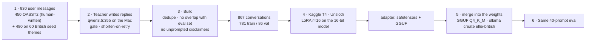

# Fine-tuning Ellie: a LoRA adapter for `llama3.2:3b`

Tier 3, item 15 ([ARCHITECTURE.md §5.2](../docs/ARCHITECTURE.md)). The app works without it.

## Why

Today Ellie's behaviour comes from a **256-token system prompt** full of rules. That has two costs:

1. **It still leaks.** With the full prompt, only 60% of replies pass every check. A third are too
   long to listen to comfortably, and some sound robotic ("I'm just a computer programme").
2. **It is slow on a CPU server.** Those 256 tokens are processed for every new conversation.

**The goal of the adapter:** the model behaves like Ellie with a **one-line prompt (52 tokens)**,
and behaves *better* than it does today with the long one.

## Baseline (measured before any training)

40 fixed prompts × 3 samples = 120 replies per row, with the app's sampling settings.
Scored on the raw model output by [`eval/score.py`](eval/score.py).

| Setup | Prompt tokens | Clean | Too long | Robotic | American | Lists/markdown | Invented life | Cut off | Facts right | Avg words |
|---|---|---|---|---|---|---|---|---|---|---|
| `llama3.2:3b` + full prompt (**the app today**) | 256 | 60% | 33% | 8% | 1% | 0% | 0% | 0% | 100% | 45 |
| `llama3.2:3b` + one-line prompt | 52 | **2.5%** | 98% | 2% | 10% | 14% | 7% | 35% | 100% | 90 |
| `qwen3.5:35b` + full prompt (**the teacher**) | 259 | **97.5%** | 2% | 1% | 0% | 0% | 0% | 0% | 100% | 38 |

**Target for the adapter, with the one-line prompt:** clean ≥ 85%, too long ≤ 10%, robotic ≤ 2%,
invented life 0%, facts still 100%.

## The pipeline



### 1. Evaluation set (`eval/`)

- [`eval/prompts.jsonl`](eval/prompts.jsonl): 40 prompts in 11 categories (small talk,
  invented-life traps, British vocabulary, advice, facts, format traps, feelings, numbers to
  speak, multi-turn memory, boundaries). 4 have known answers (Canberra, Austen, the Moon's
  distance, the user's name).
- **Held out:** training messages that resemble any of them (similarity > 0.8) are removed (6 were).
- [`eval/score.py`](eval/score.py): rule-based checks, each one traceable to the exact words that
  triggered it (10 unit tests). [`eval/run_eval.py`](eval/run_eval.py) runs a model and writes `results/`.

### 2. Dataset ([`data/`](data/build_dataset.py)): what the model learns from

| Part | Source | Why |
|---|---|---|
| **User messages** | (a) **450 real, human-written** opening messages from **OpenAssistant OASST2** (Apache-2.0): English, reviewed, low toxicity (< 0.05), 12–160 characters, no code. (b) **480 messages on 60 seed themes** written for this app ([`topics.py`](data/topics.py)): British everyday life, advice, facts and live-information questions, traps about Ellie's "life", format traps, feelings, numbers, boundaries. The teacher writes 8 varied messages per theme, typed the way people really type. | Real messages add the messy variety of how people write; themes cover what Ellie must handle. |
| **Ellie's replies** | Written by the **teacher, `qwen3.5:35b`**, locally (97.5% clean on the eval). Its prompt is the app's rules plus fixes for its own habits (below). | No hand-labelling, nothing leaves the Mac. |
| **Conversations** | 21% (184) are 2–3 turns: the teacher also writes the user's follow-up. | So follow-ups and memory keep working after training. |

**The quality gate, and what it caught.** Every reply must pass the scorer, be at most 55 words,
and avoid a few words. Reading the data turned up problems the first version of the pipeline let
through, each fixed in code rather than by hand:

| Problem found | How it was found | Fix |
|---|---|---|
| 25% of messages got no acceptable reply in 3 tries; almost all were just too long | rejection reasons logged per attempt | an over-long reply is no longer thrown away: the teacher is asked to say it again in at most 35 words. Failures dropped to 2% |
| 99% of replies ended with a question | build statistics | 35% of examples are told to end on a statement, and rejected if they don't: now 75% |
| 15% of replies said "I can't see live prices / today's news" when nobody had asked (*"How to cook Sindhi Biryani?"*) | reading samples by hand | the rule now applies only when the user asks about live information; an unprompted disclaimer is a rejection reason; those 135 were rewritten |
| "here in the cloud", "absolutely gut-wrenching" | reading the eval replies | banned in the gate |

**Final dataset** ([`data/out/stats.json`](data/out/stats.json)): 867 conversations, 781 train and
86 validation, 1,127 Ellie turns, 37 words per reply on average. Format: chat JSONL, each line
`{"messages": [system (the one-line prompt), user, assistant, ...]}`.

### 3. Training on Kaggle ([`kaggle/`](kaggle/run.sh))

`kaggle/run.sh` does it all from the Mac: uploads the data as a **private** dataset, pushes
[`kernel/train.py`](kaggle/kernel/train.py) as a **private** script on a **T4**, waits, and downloads
the output. The Kaggle key lives in its own folder, so the wrong account can never be used.

| Setting | Value |
|---|---|
| Base | `unsloth/Llama-3.2-3B-Instruct`: the same weights as Ollama's `llama3.2:3b`, no Hugging Face token needed |
| Method | LoRA with [Unsloth](https://github.com/unslothai/unsloth) on the **16-bit** model (it fits a T4's 16 GB, so no 4-bit quantisation is needed and the adapter matches the real weights) |
| LoRA | r = 16, alpha = 32, dropout 0, on all attention and MLP projections |
| Optimiser | AdamW, learning rate 2e-4, cosine, 5% warm-up, 3 epochs, best epoch kept by validation loss |
| Batch | 4 × 2 gradient accumulation; examples average 116 tokens |
| Loss | **on Ellie's turns only** (system and user tokens are masked) |
| Prompt format | built token by token in **Ollama's** llama3.2 template, which adds "Cutting Knowledge Date: December 2023" to the system turn and no date line, unlike Hugging Face's. Training on a different format from the one used at run time would waste part of what is learned |

**What the trial runs caught.** Kaggle's image now has Transformers 5.17, which removed
`warmup_ratio`. Warm-up is now computed in steps, and the script drops (and logs) any training
argument the installed version does not accept, so a renamed argument cannot fail a run.

### 4–6. Back on the Mac

```bash
training/kaggle/run.sh --fetch      # download the output of the last run
training/ollama/install.sh          # ollama create ellie-british from the merged Q4_K_M GGUF
backend/.venv/bin/python training/eval/run_eval.py adapter-short ellie-british --prompt short
```

In the app, the settings panel then shows **Model: Standard / Fine-tuned** (the backend sends the
one-line prompt to the fine-tuned model).

## Results

The final model (v2) with the **one-line prompt**, on the same 40 prompts × 3 samples as the
baseline (120 replies per row, [`eval/results/summary.json`](eval/results/summary.json)):

| Setup | Prompt tokens | Clean | Too long | Robotic | American | Lists/markdown | Invented life | Cut off | Facts right | Avg words |
|---|---|---|---|---|---|---|---|---|---|---|
| `llama3.2:3b` + one-line prompt | 52 | 1.7% | 97.5% | 1.7% | 10% | 14% | 6.7% | 35% | 100% | 90 |
| `llama3.2:3b` + full prompt (the app today) | 256 | 60% | 33% | 8.3% | 0.8% | 0% | 0% | 0% | 100% | 45 |
| **`ellie-british` + one-line prompt** | **52** | **86.7%** | **10%** | **0.8%** | **0%** | **0%** | **0%** | **0%** | 75% | **35** |
| `qwen3.5:35b` + full prompt (the teacher) | 259 | 94.2% | 1.7% | 0.8% | 0% | 0% | 0% | 0% | 100% | 38 |

- With a fifth of the prompt, the fine-tune is **far cleaner than the base model with its full
  prompt** (86.7% vs 60%) and close to the 35B teacher that wrote its training data: short,
  spoken, British, no lists, never pretending to have a life.
- **The cost:** 3 of the 12 fact answers were wrong (75%), where the base model got all 12. A small
  model loses a little knowledge when its style is retrained; v2 halved the learning rate and
  trained for 2 epochs instead of 3 after v1 did worse on facts ([`results/`](results/)).
- It met the targets for length, robotic replies and invented life, and came close on clean
  replies (86.7%, target 85%).

**Training runs.** Both runs used a T4 GPU. The final one ran on Google Colab, driven from the command line
([`colab/`](colab/)): LoRA r = 16 at learning rate 1e-4 for 2 epochs, about 7 minutes. Ollama 0.40
no longer loads separate LoRA adapters, so the adapter is merged into the weights and quantised to
Q4_K_M with llama.cpp, like the base model ([`ollama/install.sh`](ollama/install.sh)).

## Commands

```bash
backend/.venv/bin/python -m pytest training/eval -q --rootdir training/eval    # scorer tests
backend/.venv/bin/python training/eval/run_eval.py base-full llama3.2:3b --prompt full
backend/.venv/bin/python training/eval/run_eval.py base-full --rescore         # after editing checks
training/.venv/bin/python training/data/build_dataset.py messages | replies | build
```
